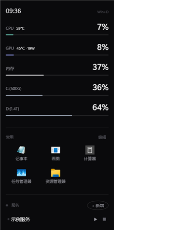
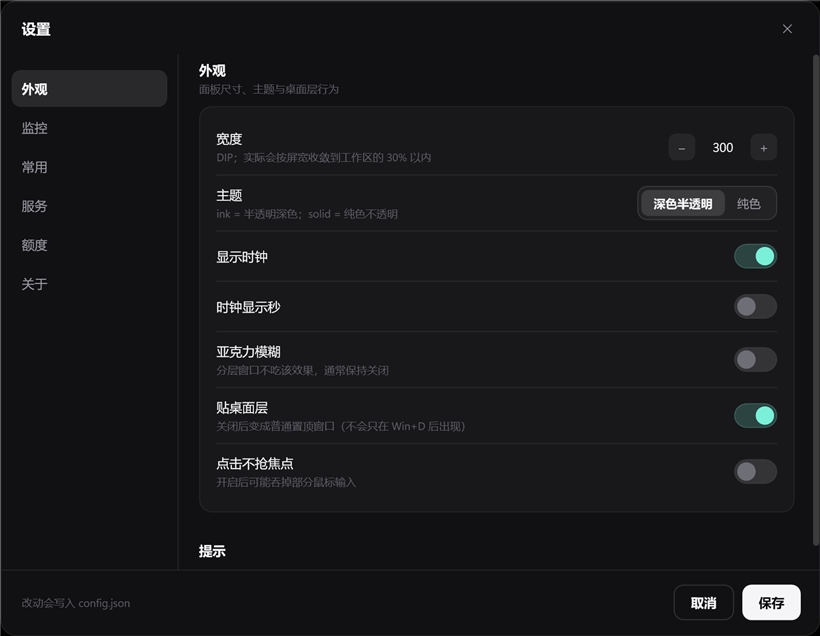

# DeskPanel

Windows 桌面右侧的常驻侧栏：硬件监控、常用软件、服务开关、开机启动项，贴在桌面层，`Win+D` 后可见，不占任务栏、不抢焦点。

Windows 10/11 x64 · WPF / .NET 8 · MIT · [变更记录](CHANGELOG.md)



面板右上角的齿轮（或托盘菜单「设置…」）打开可视化设置：



## 功能

| 模块 | 说明 |
|---|---|
| **硬件监控** | CPU 占用（PDH）、GPU 3D 引擎占用（PDH）、内存占用、指定盘符占用（含总容量）、CPU 温度（PDH `\Thermal Zone Information(*)\Temperature`，ACPI 热区，无需管理员）、GPU 温度与功耗（NVIDIA NVML，用户态 `nvml.dll`，无需管理员）。数值条带弹簧动画（`Omega=17/Zeta=0.58`），>75℃ 琥珀、>85℃ 红。 |
| **常用软件** | 磁贴网格，点一下启动；支持从资源管理器 / 桌面拖 `exe` / `lnk` / 文件夹 / 网址进来添加；右键可编辑、删除、在资源管理器中显示；图标优先取 exe 内嵌图标（`ExtractIconEx`），退回 shell 图标，网址用 favicon；超出可视行数时内部滚轮滚动，不显示滚动条。 |
| **服务启动器** | 完全由 config 的 `Services` 数组驱动（名字 + 启动命令 + 进程名 + 可选 `StopMatch`）。点标题右侧 `+ 新增` 直接在界面里添加（命令 / 参数 / 工作目录 / 进程名都有表单），右键条目可编辑 / 删除。每行显示运行中指示灯，点 `▶` 启动、点 `■` 停止。 |
| **开机启动项** | 三类来源一起读：HKCU / HKLM 的 Run、用户启动文件夹、**打包应用（Microsoft Store / MSIX）的启动任务**（Codex、AMD Radeon、ControlCenter 这类在任务管理器里标「应用」的项）。按名字混排，开关直接改系统真实状态（`StartupApproved` / 任务 `State`），不删除任何东西；支持「+ 新增」、右键禁用 / 启用 / 移除 / 打开位置；列表内部滚动，不显示滚动条。 |
| **额度区**（可选，默认关闭） | 点「额度」可在两种视图间切换，带淡出 / 上浮动画：<br>a) OpenCode Go 订阅额度：5 小时 / 本周 / 本月三环，显示已用百分比与重置倒计时；<br>b) DeepSeek 官方余额：`GET https://api.deepseek.com/user/balance`，显示总余额 + 赠金 / 充值明细，≤5 元转琥珀色。<br>需要配 key 才能取数；`Enabled=false` 时整块隐藏，也不发网络请求。 |
| **自适应布局** | 宽度按屏宽收敛（≤ 工作区 30%）；按工作区高度决定密度；装不下先减行、再整体等比缩小（最低 0.75），保证底部额度不被裁。插拔显示器 / 改缩放 / 虚拟显示器（远程桌面等）切换时自动重新贴边——用物理像素 +「鼠标所在屏」选屏，不依赖 WPF 的 DIP 工作区。 |
| **自动检测更新** | 启动后与每隔几小时（默认 6）查 GitHub Release；有新版时齿轮上出现小圆点、托盘显示「有新版 · 去下载」。设置 → 关于里可开关与手动检查。只做检测和跳转，不自动替换程序。 |
| **可视化设置** | 面板右上角齿轮或托盘「设置…」打开：左侧分区导航 + 卡片式表单，改动点「保存」才落盘。外观（宽度 / 主题 / 时钟 / 桌面层 / 亚克力 / 不抢焦点）、监控（刷新间隔、要显示的磁盘）、常用（列数 / 可见行数）、服务（列表增删改）、额度（开关 / 视图 / 两个 key，默认掩码可点「显示」）、关于（版本、开机自启、打开配置与日志）。 |
| **其它** | 托盘右键菜单：设置…、开机自启（勾选）、面板宽度（260/300/340/380 DIP）、刷新启动项、重新载入配置（不重启进程）、打开配置文件 / 配置目录、退出。时钟、`Win+D` 后自动浮到桌面层、无边框圆角。配置存 `%LOCALAPPDATA%\DeskPanel\config.json`，日志 `app.log`。 |

## 安装与使用

### 下载即用

1. 在 GitHub Releases 页下载最新的 zip。
2. 解压到任意可写目录，**保持目录内的文件完整**。
3. 双击 `DeskPanel.exe`。首次启动会在 `%LOCALAPPDATA%\DeskPanel\` 生成 `config.json` 和 `app.log`。
4. 按 `Win+D` 回到桌面，右侧即出现面板；托盘图标可显示 / 隐藏 / 退出。

无需安装、不写 `Program Files`、不请求管理员权限。

### 上手三件事

- **加软件**：把 `exe` / `.lnk` / 文件夹 / 网址从桌面或资源管理器拖进「常用」区；也可以点「编辑」再点 `+` 手动添加。
- **加服务**：点「服务」标题右侧的 `+ 新增`，填启动命令和进程名即可；也可以直接编辑 `config.json` 的 `Services` 数组（见下）。
- **开机自启**：在「开机启动」区点「+ 新增」把自己加进去，或者把 `DeskPanel.exe` 的快捷方式放进启动文件夹。
- **调参数**：点面板右上角齿轮 → 设置，改宽度、刷新间隔、常用列数、服务、额度都在这里，不用手改 JSON。

### 从源码构建

前置：Windows 10/11 x64 + .NET 8 SDK。在仓库根目录执行：

```powershell
dotnet publish src/DeskPanel/DeskPanel.csproj -c Release -r win-x64 `
  --self-contained true -p:PublishSingleFile=false -p:DebugType=none -o publish
```

发布产物直接运行 `publish\DeskPanel.exe`；`DeskPanel.exe --settings` 可以直接打开设置（面板已在运行时也能把请求转发给已运行的实例）。

> **必须 `PublishSingleFile=false`。** 单文件自解压在部分环境起不来（`Failure processing application bundle`），多文件发布已验证可用。分发时整份 `publish\` 目录一起打包，不要只拷 exe。

## 配置

配置文件：`%LOCALAPPDATA%\DeskPanel\config.json`，首次启动自动生成。**绝大多数选项可以直接在「设置」里改**，下面的 JSON 是同一份配置的对照说明。手工修改后，在托盘菜单点「重新载入配置」可即时生效：常用磁贴（含列数/可见行数）、服务、额度开关与视图、宽度、刷新间隔、监控盘符。只有主题、亚克力、贴桌面层、点击不抢焦点需要重启面板。

```json
{
  "Width": 300,
  "RefreshMs": 1000,
  "Theme": "ink",
  "Acrylic": false,
  "ShowClock": true,
  "ClockSeconds": 0,
  "DesktopLayer": true,
  "NoActivate": false,
  "Drives": ["C:", "D:"],
  "Launcher": {
    "Columns": 3,
    "MaxRows": 3,
    "Apps": [
      { "Name": "记事本", "Target": "C:\\Windows\\notepad.exe", "Args": "", "Icon": "" }
    ]
  },
  "Services": [
    {
      "Name": "示例服务",
      "StartCommand": "C:\\path\\to\\start.bat",
      "StartArgs": "",
      "WorkingDir": "",
      "ProcessNames": ["python"],
      "StopMatch": "main.py"
    }
  ],
  "Usage": {
    "Enabled": false,
    "Mode": "go",
    "OpenCodeKey": "",
    "DeepSeekKey": ""
  }
}
```

| 字段 | 说明 |
|---|---|
| `Width` | 面板目标宽度（DIP），默认 `300`；实际会按屏宽收敛到工作区的 30% 以内。 |
| `RefreshMs` | 硬件指标刷新间隔（毫秒），默认 `1000`。 |
| `Theme` | 主题，默认 `ink`（深色半透明）；`solid` 为纯色。 |
| `Acrylic` | 亚克力毛玻璃开关，默认 `false`；分层窗口不吃该效果，实际观感由半透明背景决定。 |
| `ShowClock` | 是否显示时钟，默认 `true`。 |
| `ClockSeconds` | 时钟是否带秒，默认 `0`（只显示 `HH:mm`），取值 0–59。 |
| `DesktopLayer` | 是否贴桌面层，默认 `true`（`Win+D` 后可见）；`false` 变成普通置顶窗口。 |
| `NoActivate` | `true` 时点击不抢焦点，默认 `false`；开启后可能吞掉部分鼠标输入。 |
| `Drives` | 要监控的盘符，例如 `["C:", "D:"]`；留空数组时自动取前两块固定盘。 |
| `Launcher` | 常用软件区配置：列数、可见行数与磁贴清单。 |
| `Launcher.Columns` | 常用软件每行几个磁贴，默认 `3`。 |
| `Launcher.MaxRows` | 可见行数，默认 `3`；超出后内部滚动，不显示滚动条。 |
| `Launcher.Apps` | 磁贴清单，每项一个程序 / 快捷方式 / 文件夹 / 网址。 |
| `Apps[].Name` | 磁贴显示名称。 |
| `Apps[].Target` | 启动目标：`exe`、`.lnk`、文件夹路径或网址。 |
| `Apps[].Args` | 启动参数，没有就留空。 |
| `Apps[].Icon` | 自定义图标文件；留空则自动取图标（exe 内嵌 → shell 图标，网址用 favicon）。 |
| `Services` | 服务清单；数组为空时服务区只留「+ 新增」入口和一行提示。 |
| `Services[].Name` | 服务行标题。 |
| `Services[].StartCommand` | 启动命令，支持 `.exe` / `.bat` / `.cmd` / `.ps1`。 |
| `Services[].StartArgs` | 启动参数，没有就留空。 |
| `Services[].WorkingDir` | 工作目录；留空用命令所在目录。 |
| `Services[].ProcessNames` | 判断「在跑」的进程名（不带 `.exe`），例如 `["python"]`。 |
| `Services[].StopMatch` | 可选，停止时按命令行关键字匹配，用于区分同名进程。 |
| `Usage` | 额度区配置：开关、视图与两个 key。 |
| `Usage.Enabled` | 是否开启额度区，默认 `false`；关闭时整块隐藏且不联网。 |
| `Usage.Mode` | 额度视图，默认 `go`（OpenCode Go 三环）；`deepseek` 为 DeepSeek 余额。 |
| `Usage.OpenCodeKey` | OpenCode Go 的 key；留空则读环境变量 `OPENCODE_GO_API_KEY`。 |
| `Usage.DeepSeekKey` | DeepSeek 的 key；留空则读环境变量 `DEEPSEEK_API_KEY`。 |

config 里的 key 优先于环境变量。`Usage.Enabled=false` 时不会发出任何额度相关请求。

## 常见问题

**为什么 `Win+D` 才看得见？**

面板挂在桌面层（Progman / WorkerW），和壁纸同一层：普通窗口打开时被自然盖住，回到桌面才露出来。这样它不占任务栏、不挡工作窗口，鼠标移上去又能直接点。

**为什么没有风扇转速 / 显存？**

风扇、显存这类传感器通常要走笔记本 EC 或厂商驱动，需要内核驱动 + 管理员权限。本项目坚持零管理员、零驱动，只读 PDH 与 NVML 的用户态接口。

**温度显示不准？**

CPU 温度读的是 ACPI 热区（PDH `\Thermal Zone Information(*)\Temperature`），不是核心 DTS。部分机型只暴露一两个热区，读数会偏平或偏高，适合看趋势，不适合当精确值。

**面板跑到屏幕外？**

已修。现在用物理像素 +「鼠标所在屏」选屏贴边，插拔显示器、修改缩放、远程桌面等虚拟显示器切换后都会自动重新定位，不依赖 WPF 的 DIP 工作区。

**能开机自启吗？**

可以。两种方式任选：在面板「开机启动」区点「+ 新增」把自己加进去；或把 `DeskPanel.exe` 的快捷方式放进 `shell:startup`。

## 隐私

- 默认不联网。只有明确开启额度区（`Usage.Enabled=true`）时才会请求 OpenCode Go / DeepSeek 的接口。
- 不收集、不上传任何数据；没有统计、没有崩溃上报。
- 配置与日志只在本机：`%LOCALAPPDATA%\DeskPanel\config.json`、`%LOCALAPPDATA%\DeskPanel\app.log`。
- API key 只从本机 config 或环境变量读取。

## License

本项目以 [MIT](LICENSE) 协议发布。代码全部自写，不含第三方 GPL 代码。
